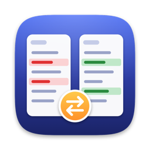
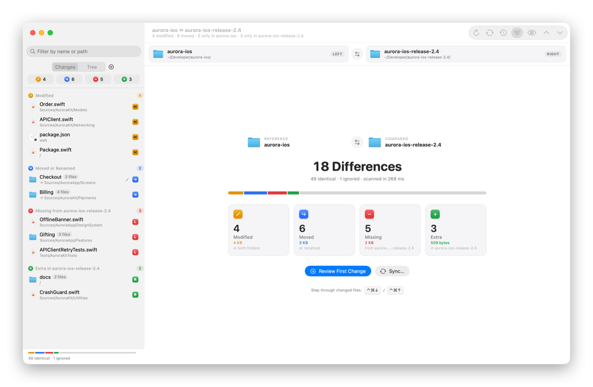
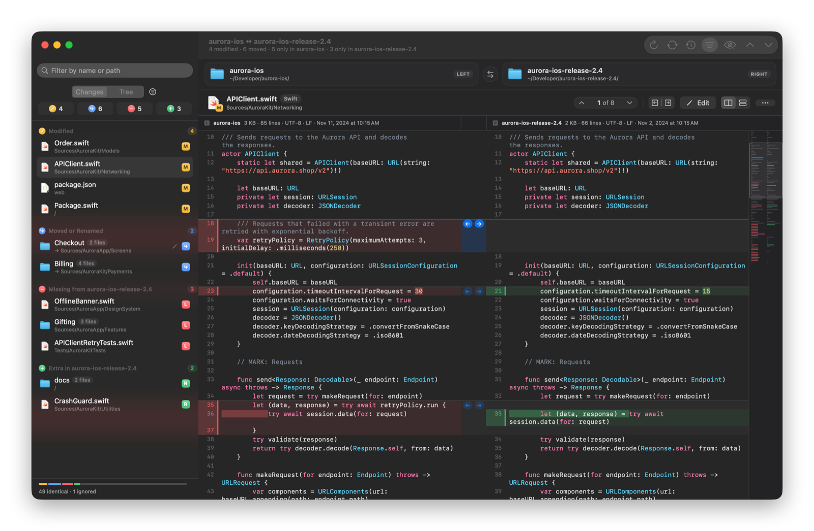
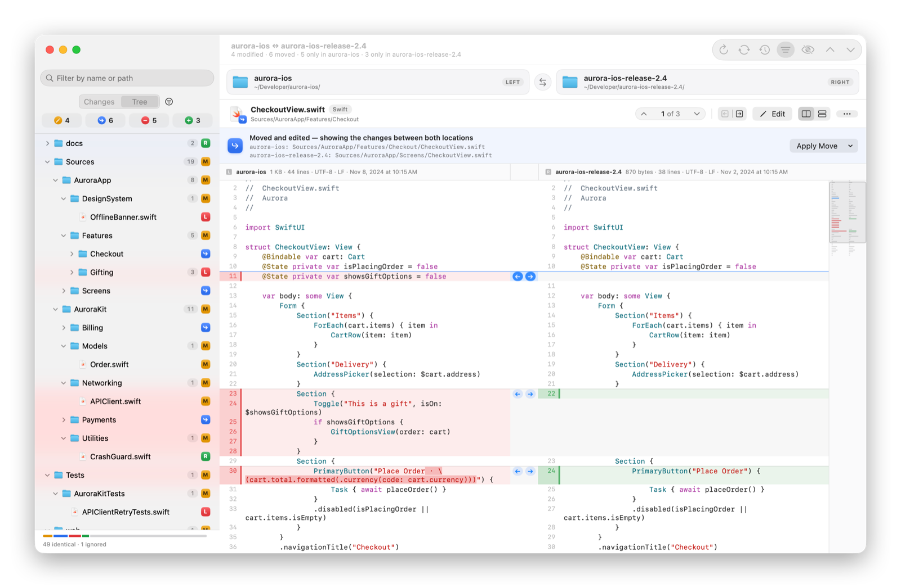
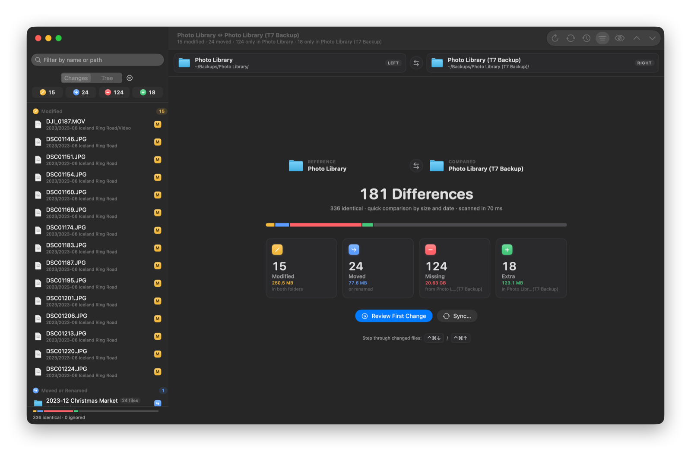
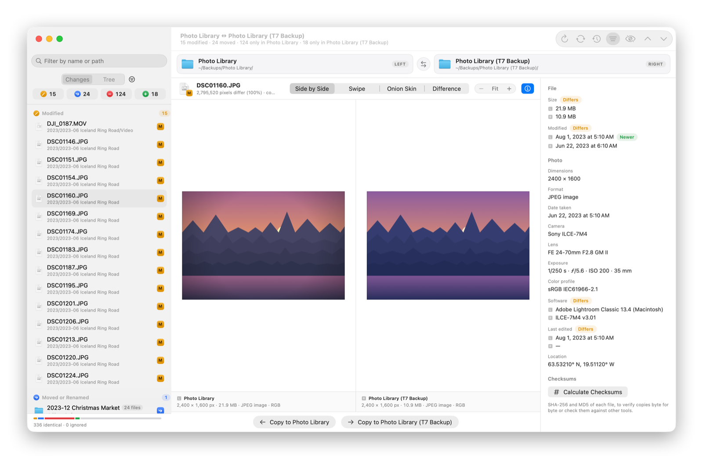
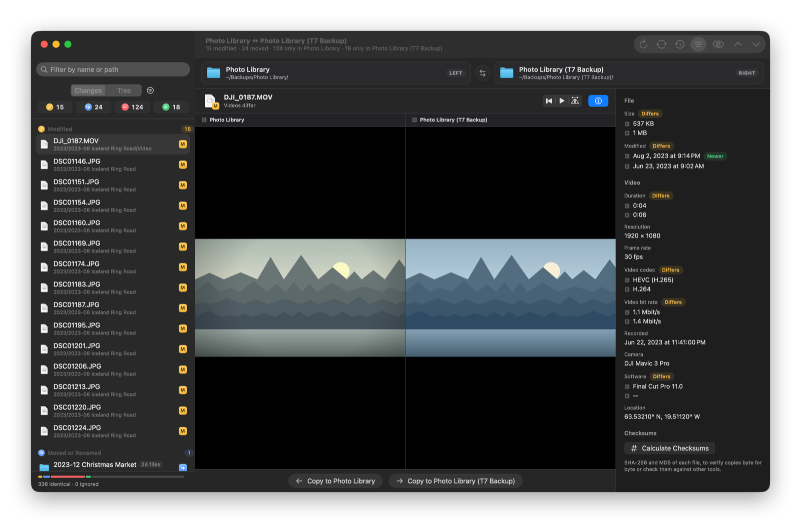
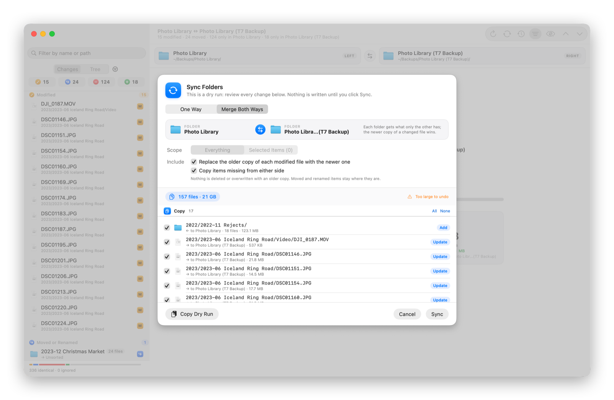
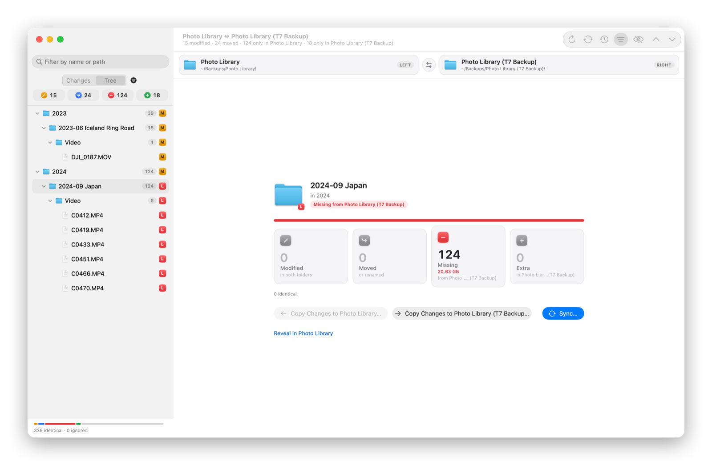

  

<h1 align="center">PathDiff</h1>

  <strong>See exactly what's different between two folders, then make them match.</strong> 
  Compare code projects, photo libraries and backup drives on your Mac. Review every change side by side, then sync safely with a preview and undo.

  <a href="https://apps.apple.com/app/id6826374257"><strong>Try it free on the Mac App Store</strong></a>
  ·
  <a href="docs/FEATURES.md">All features</a>
  ·
  <a href="docs/FAQ.md">FAQ</a>
  ·
  <a href="SUPPORT.md">Support</a>

  

Drop two folders onto PathDiff and within seconds you know everything: which files changed, which moved, what's missing and what's extra, with the size of each group. Then review the changes in code, photos and videos side by side, and sync the folders safely. Every step is previewed first and can be undone.

## Who it's for

- **Developers.** Compare a downloaded release with your main copy, two exports of a repository, or yesterday's backup of a project. PathDiff respects every folder's `.gitignore`, recognizes renamed files and folders, and shows real diffs with syntax highlighting.
- **Photographers and video creators.** Check whether your backup drive really has everything. PathDiff finds the shoots that never made it to the backup, the photos you edited since, and the files you reorganized, and tells you how many gigabytes are involved.
- **Anyone with two copies of anything.** Old laptop and new laptop. Two external drives. A shared folder and your local copy. If two folders are supposed to match, PathDiff tells you whether they do, and fixes it when they don't.

## Highlights

### Every difference, sorted and sized

PathDiff sorts every difference into four groups: **modified**, **moved**, **missing** and **extra**. Each group shows its file count and total size, so you know at a glance whether you're looking at 4 KB of edits or 20 GB of missing videos. Click a group to list just those files, or browse the full folder tree.

### Diffs that are a pleasure to read

Side-by-side or unified, with the exact changed words highlighted, syntax colors for about 25 languages and a minimap of every change. Jump from change to change with the keyboard, copy a single block to the other side, or edit both files right in the diff. Saving keeps each file's encoding and line endings.

### It knows when a file just moved

Most compare tools report a renamed folder as hundreds of deleted and added files. PathDiff recognizes moved files by their contents, matches files that were moved *and* edited, and reports a renamed folder as a single move. One click applies the move on the other side.

### Is your backup really complete?

Point PathDiff at your photo library and your backup drive. It shows the trip that was never backed up, the photos you edited after the last backup, and the ones you reorganized. For drives full of large videos, the **Quick** comparison trusts matching sizes and dates and only reads files that might differ. It even allows for the 2-second date rounding of exFAT and FAT drives.

### Compare photos like a photographer

Side by side, swipe, onion skin, or a map of every changed pixel, with up to 16× zoom. The details panel lines up what both files say about themselves (camera, lens, exposure, date taken, location, editing software) and marks what differs and which copy is newer. Works with JPEG, HEIC, PNG, TIFF, RAW, PDF, SVG and more.

### Videos and audio, side by side

Two players you can start, pause, rewind and line up together. Compare duration, resolution, frame rate, codec, bit rate, recording date and camera. Re-exports and trims become obvious.

### Sync without the anxiety

Sync one way, mirror, or **merge both ways** so each folder gets what only the other has. Before anything is written, PathDiff lists every single operation so you can untick what you don't want. Then:

- **Undo anything.** The whole sync is one ⌘Z, even if you stopped it halfway.
- **Revert later.** Sync History keeps backups of what was overwritten, so you can revert a change even after relaunching.
- **Nothing is deleted outright.** Removed items go to the Trash. Merge Both Ways never removes anything.
- **No surprises.** The preview stays up to date as files change, and PathDiff never overwrites a file or folder it didn't plan to replace. Folders it couldn't read are left untouched.

### Find exactly what you're looking for

Filter by file type (photos, videos, audio, documents, code, archives), by kind of change, or by name and path. Select any folder to see what changed inside it, with sizes.

## Built for big folders

PathDiff is a native Mac app made for very large folders. On two folders with 150,000 files each:

| | Time |
| --- | --- |
| First comparison | about 8.6 seconds |
| Refresh, or reopening after a relaunch | about 2 seconds |
| Sidebar update or search keystroke | 1–5 milliseconds |

Folders are scanned in parallel and results are remembered between launches, so a refresh only reads files that changed. Open comparisons update on their own when files change.

## Private by design

- **Works entirely offline.** No sign-up, no cloud, no analytics, no uploads.
- **Sandboxed.** PathDiff can only see the folders you choose.
- **Your files stay where they are.** Nothing is written until you confirm, and removals go to the Trash.
- **Open source.** Every line of PathDiff is [public](#about-this-repository), so anyone can check what it does with your files.

Read the full [privacy policy](PRIVACY.md).

## Speaks your language

Fully translated into 23 languages, written in each language's own macOS terms:

English, Bahasa Indonesia, Dansk, Deutsch, Español, Français, Italiano, Nederlands, Norsk bokmål, Polski, Português (Brasil), Suomi, Svenska, Tiếng Việt, Türkçe, Русский, العربية, हिन्दी, ไทย, 日本語, 한국어, 简体中文, 繁體中文.

## Get PathDiff

PathDiff is available on the **[Mac App Store](https://apps.apple.com/app/id6826374257)**. Try it free for a week; after that, a yearly subscription of 3 USD (or the local equivalent) keeps everything unlocked, and Family Sharing lets up to five family members use it. It needs a Mac with Apple silicon running macOS 27 or later. Updates arrive through the App Store.

## Feedback

Found a bug, or wish PathDiff did something it doesn't? [Open an issue](https://github.com/OpenAppBox/PathDiff/issues/new/choose) and choose the template that fits. We read every report. See [Support](SUPPORT.md) for what to include.

## About this repository

The complete source code of PathDiff is published here as free software under the [GPL v3.0](LICENSE), so you can see how it works and what it does with your files. PathDiff is developed by the OpenAppBox team; we don't accept pull requests and can't help with building or changing the code (see [Contributing](CONTRIBUTING.md)). The Mac App Store version is the only supported way to use PathDiff.

PathDiff is written in Swift with SwiftUI. If you want to look around:

| Folder | What's inside |
| --- | --- |
| `PathDiff/Models` | The comparison tree, text documents and line diffs |
| `PathDiff/Services` | Scanning and comparing folders, move detection, the diff engine, syntax highlighting, image and media comparison, sync and history |
| `PathDiff/ViewModels` | Window state, syncing, editing and settings |
| `PathDiff/Views` | The SwiftUI interface |
| `PathDiffTests` | The test suite (Swift Testing) |

## License

PathDiff is free software, released under the [GNU General Public License v3.0](LICENSE). Copyright © 2026 OpenAppBox.

The license covers the source code in this repository. The PathDiff app on the Mac App Store is built from the same code by OpenAppBox, its copyright holder.

---

  PathDiff is <strong>an OpenAppBox app</strong> · <a href="https://openappbox.com">openappbox.com</a>

